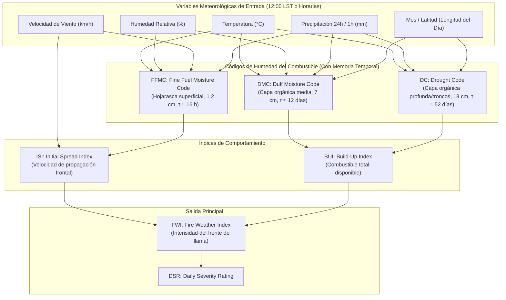
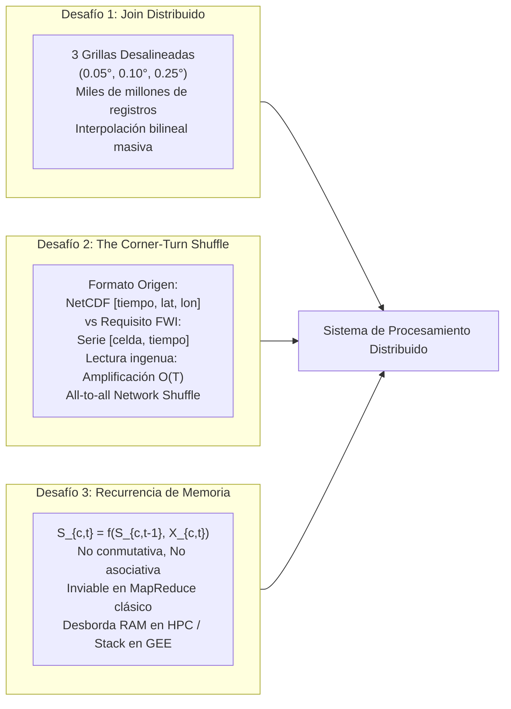
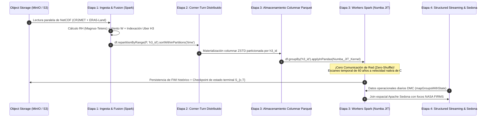
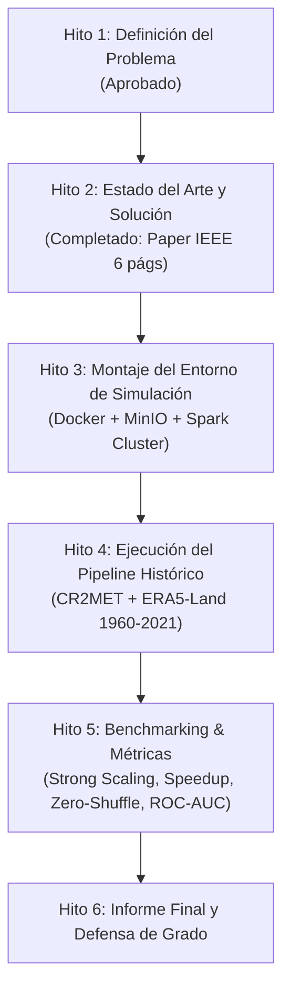

# Proyecto Big Data: Distributed Processing for Continental-Scale Wildfire Danger Estimation in Chile (1960–2100)

**Documento Maestro de Contexto, Evolución Histórica y Arquitectura Técnica**  
*Universidad Diego Portales (UDP) — Facultad de Ingeniería y Ciencias*  
*Magíster / Curso: Sistemas de Procesamiento para Big Data*  
*Profesor Guía:* Dr. Nicolás Hidalgo (`nicolas.hidalgoc@mail.udp.cl`)  
*Autores / Equipo de Trabajo:*  
- **Agustín Pizarro**  
- **Eduardo Valenzuela**  
- **Benjamín Zúñiga**  

---

## Índice General

1. [Ficha Técnica y Estado del Proyecto](#1-ficha-técnica-y-estado-del-proyecto)
2. [Génesis de la Idea y Motivación Nacional](#2-génesis-de-la-idea-y-motivación-nacional)
3. [Fundamentos Científicos del Canadian Fire Weather Index (FWI)](#3-fundamentos-científicos-del-canadian-fire-weather-index-fwi)
4. [Hito 1: Propuesta Inicial y Presentación Oral](#4-hito-1-propuesta-inicial-y-presentación-oral)
5. [El Punto de Inflexión: El Feedback del Profesor Dr. Nicolás Hidalgo](#5-el-punto-de-inflexión-el-feedback-del-profesor-dr-nicolás-hidalgo)
6. [Auditoría Bibliográfica y el Descubrimiento Crítico de Datos](#6-auditoría-bibliográfica-y-el-descubrimiento-crítico-de-datos)
7. [Desmontando las Dudas del Profesor: Los 3 Cuellos de Botella de Big Data](#7-desmontando-las-dudas-del-profesor-los-3-cuellos-de-botella-de-big-data)
8. [Arquitectura de Solución Propuesta (Hito 2 - Paper IEEE)](#8-arquitectura-de-solución-propuesta-hito-2---paper-ieee)
9. [Ecosistema Tecnológico: ¿Por qué Spark y Parquet?](#9-ecosistema-tecnológico-por-qué-spark-y-parquet)
10. [Organización del Repositorio y Guía de Compilación](#10-organización-del-repositorio-y-guía-de-compilación)
11. [Roadmap y Próximos Pasos](#11-roadmap-y-próximos-pasos)

---

## 1. Ficha Técnica y Estado del Proyecto

- **Nombre Formal en Inglés:** *Distributed Processing for Continental-Scale Wildfire Danger Estimation in Chile (1960–2100)*.
- **Área de Estudio:** Sistemas Distribuidos, Ingeniería de Datos Masivos, Procesamiento Geoespacial y Modelamiento Ambiental.
- **Hitos Cumplidos:**
  * **Hito 1:** Definición del Problema y Propuesta de Proyecto (Aprobado).
  * **Presentación Oral:** Exposición de diapositivas Beamer ante el profesor (Aprobada).
  * **Hito 2:** Estado del Arte y Propuesta de Solución bajo estándar IEEE (Completado: Paper formal de 6 páginas, auditoría de 18 papers y diseño arquitectónico).
- **Entorno de Simulación:** Cluster virtualizado en Docker con restricciones de recursos (`cgroups`), almacenamiento de objetos MinIO S3 y Apache Spark.

---

## 2. Génesis de la Idea y Motivación Nacional

### La Crisis de Incendios en Chile y la Megasequía
Chile central y sur atraviesa desde el año 2010 la denominada **Megasequía**, el evento de déficit hídrico más prolongado e intenso en más de un milenio según los registros dendrocronológicos. Esta desecación continua de los suelos y combustibles vegetales ha transformado radicalmente el régimen de incendios del país:

- **Enero 2017 ("La Tormenta de Fuego"):** El complejo de incendios de Las Máquinas y zonas aledañas consumió más de 570.000 hectáreas en las regiones de O'Higgins, Maule y Biobío, destruyendo por completo poblados como Santa Olga.
- **Febrero 2023:** Olas de calor con temperaturas sobre 41 °C y vientos Puelche de alta velocidad provocaron incendios simultáneos en Biobío, Ñuble y La Araucanía, quemando más de 440.000 hectáreas y causando 26 fallecidos.
- **Febrero 2024:** En la interfaz urbano-forestal de la Región de Valparaíso (Viña del Mar y Quilpué), un megaincendio provocó la tragedia más letal en décadas, cobrando más de 130 vidas y destruyendo más de 15.000 viviendas.

Estos eventos ya no son incendios convencionales, sino **megaincendios de sexta generación**: fuegos de comportamiento extremo capaces de modificar la atmósfera local (generando pirocumulonimbos, tormentas eléctricas inducidas por fuego y saltos de pavesas a kilómetros de distancia).

### La Pregunta Central de Investigación
Frente a esta realidad, organismos como CONAF y SENAPRED requieren mapas de peligro meteorológico con alta resolución espacial y temporal. Los modelos actuales se ejecutan en resoluciones gruesas (~28 km) o para estaciones meteorológicas puntuales aisladas.

Nos propusimos responder:  
> *¿Cómo diseñar una arquitectura de computación distribuida capaz de computar el peligro de incendios a escala continental para todo Chile a alta resolución (celdas de ~3 a 5 km), abarcando más de 60 años de historia diaria/horaria (1960–presente) y proyectando escenarios climáticos multimodelo hacia el año 2100?*

---

## 3. Fundamentos Científicos del Canadian Fire Weather Index (FWI)

El sistema de peligro meteorológico de incendios adoptado internacionalmente y por CONAF es el **Canadian Forest Fire Weather Index (CFFDRS / FWI)**, formalizado matemáticamente por Van Wagner (1987) y actualizado en la literatura reciente (FWI2025).

El FWI modela el contenido de humedad de distintas capas del suelo y del combustible forestal a través de un sistema acoplado de ecuaciones diferenciales discretizadas.



### Comportamiento de los Tres Códigos de Humedad
1. **FFMC (Fine Fuel Moisture Code):**
   - Evalúa la facilidad de ignición y propagación en la hojarasca fina superficial (profundidad ~1.2 cm).
   - Su tiempo de respuesta característico (retardo exponencial $\tau$) es de solo **16 horas**. Reacciona inmediatamente a cambios de temperatura diurnos y ráfagas de viento.
2. **DMC (Duff Moisture Code):**
   - Representa el contenido de humedad de la capa de materia orgánica en descomposición moderada (~7 cm de profundidad).
   - Retardo exponencial $\tau \approx$ **12 días**. Modela cómo las semanas previas secan los estratos medios del suelo.
3. **DC (Drought Code):**
   - Indicador de sequedad estacional profunda (combustibles pesados y horizontes orgánicos profundos, ~18 cm).
   - Retardo exponencial $\tau \approx$ **52 días**. Posee una memoria temporal acumulativa que arrastra el déficit hídrico de varios meses.

---

## 4. Hito 1: Propuesta Inicial y Presentación Oral

En el primer hito del curso entregamos la definición inicial del problema:

1. **Documento de Propuesta (`Propuesta/propuesta_proyecto_fwi_bigdata.tex`):**
   - Planteó la necesidad de calcular el FWI utilizando el producto de reanálisis **CR2MET v2.5** (desarrollado por el Centro de Ciencia del Clima y la Resiliencia, CR2) a $0.05^\circ$ (~5 km).
   - Se propuso un pipeline conceptual basado en Apache Spark y almacenamiento en formato Apache Parquet.
2. **Presentación de Diapositivas Beamer (`Presentaciones/slides_presentacion_fwi.tex`):**
   - Diseñada para exponer el contexto del problema, el cálculo del índice y el diseño conceptual de la arquitectura.
3. **Guion Oral de Exposición (`Presentaciones/guion_problema_presentacion.tex`):**
   - Asignado a Eduardo Valenzuela para defender la diapositiva *"The problem we want to address"*, con énfasis en las consecuencias socioecológicas de los megaincendios y la formulación del problema desde la perspectiva de sistemas de procesamiento de datos.

---

## 5. El Punto de Inflexión: El Feedback del Profesor Dr. Nicolás Hidalgo

Al evaluar la propuesta y la presentación oral, al profesor Dr. Nicolás Hidalgo **le encantó la temática e impacto del proyecto**, pero planteó una observación crítica y escéptica de arquitectura de sistemas:

> *"El índice FWI se calcula mediante fórmulas matemáticas explícitas relativamente sencillas (ecuaciones algebraicas y exponenciales). ¿Por qué esto amerita un cluster distribuido de Big Data? ¿Por qué no se resuelve simplemente con un script de Python de 50 líneas corriendo en una laptop? Si la fórmula no es intensiva en CPU, ¿dónde está el verdadero problema de Big Data?"*

Adicionalmente, el profesor fijó los requerimientos formales para el **Hito 2 (Estado del Arte y Propuesta de Solución)**:
- Documento formal en LaTeX bajo la plantilla oficial **IEEE Conference (`IEEEtran.cls`)**, en inglés, fuente 10pt, dos columnas.
- Extensión mínima de **2 páginas**.
- Título y Abstract rigurosos.
- Revisión de **al menos 12 referencias relevantes** analizadas críticamente en la sección de *Related Work*.
- Discusión profunda y tabla taxonómica que justifique la brecha de investigación (*Research Gap*).
- Descripción detallada de la arquitectura de solución: pipeline de datos, cluster distribuido, metodología de simulación y evaluación con tecnologías Big Data (Spark, Hadoop, Dask, etc.).
- **Condición clave:** Fase de investigación y propuesta en papel (sin desarrollo de código ni montaje en servidores todavía).

---

## 6. Auditoría Bibliográfica y el Descubrimiento Crítico de Datos

Para responder con rigor científico a las exigencias del profesor y a la pauta de `Paper_instructions.md`, llevamos a cabo una investigación profunda que arrojó un hallazgo fundamental.

### El Hallazgo Crítico sobre CR2MET v2.5
Al auditar los metadatos y esquemas del repositorio oficial de CR2MET v2.5 en Zenodo (`10.5281/zenodo.7529682`), descubrimos un hecho determinante:

> **CR2MET v2.5 ÚNICAMENTE provee datos de Precipitación (`pr`, 2.54 GB) y Temperatura extrema (`tmin` y `tmax`, 6.78 GB). NO INCLUYE Humedad Relativa ($RH$) ni Velocidad del Viento ($W$).**

**Consecuencia directa:** Es **imposible** calcular el FWI utilizando únicamente CR2MET. Quien intente calcular el FWI con CR2MET aislado fracasará por falta de variables termodinámicas. Esto derribó la hipótesis inicial de que el proyecto consistía en procesar un simple archivo NetCDF local y transformó el problema en una **fusión espaciotemporal multifuente distribuida**.

### El Ecosistema de 6 Fuentes de Datos Integradas

| Dataset / API | Variables Involucradas | Resolución Espacial / Temporal | Cobertura Temporal | Volumen en Chile | Propósito en la Arquitectura |
| :--- | :--- | :--- | :--- | :--- | :--- |
| **CR2MET v2.5** | `pr, tmin, tmax` | $0.05^\circ$ (~5 km), Diaria | 1960 – 2021 | 9.3 GB | Base topográfica y orográfica calibrada con estaciones chilenas. |
| **ERA5-Land (ECMWF)** | `t2m, d2m, u10, v10, tp` | $0.10^\circ$ (~9 km), Horaria | 1950 – Presente | ~165 GB | Aporte de humedad y viento: derivación de $RH$ horaria vía Magnus-Tetens y magnitud de $W$. |
| **NASA NEX-GDDP-CMIP6** | `tasmax, pr, hurs, sfcWind` | $0.25^\circ$ (~25 km), Diaria (35 GCMs) | 1950 – 2100 | ~420 GB (38 TB global) | Proyecciones climáticas multimodelo bajo escenarios de emisiones SSP2-4.5 y SSP5-8.5. |
| **Copernicus CEMS-FWI** | Histórico `FWI, FFMC, DC` | $0.25^\circ$, Diaria | 1940 – Presente | 12 GB | Calibración cruzada y baseline comparativo de baja resolución. |
| **NASA FIRMS (VIIRS/MODIS)**| Puntos activos, `frp` | 375 m / 1 km, Puntos diarios | 2000 – Presente | 450 MB | Validación geoespacial de predicción frente a incendios reales observados. |
| **Catálogo CONAF** | Coordenadas, ignición, ha | Puntos por evento | 1985 – 2024 | 85 MB | Verdad de terreno para validación mediante curvas ROC-AUC. |

---

## 7. Desmontando las Dudas del Profesor: Los 3 Cuellos de Botella de Big Data

Con estos datos auditados, demostramos formalmente por qué este es un problema mayúsculo de **Sistemas Distribuidos y Big Data** y por qué una laptop colapsa:



### Cuello de Botella 1: La Fusión Espaciotemporal Multifuente
No existe un único archivo preprocesado. El cluster debe alinear e interpolar bilinealmente variables provenientes de tres mallas espaciales distintas ($0.05^\circ, 0.10^\circ, 0.25^\circ$) a través de $1.6 \times 10^4$ timesteps diarios y $>6.5 \times 10^5$ timesteps horarios sobre 120.000 celdas chilenas, expandiendo el volumen sin comprimir a **más de 2 Terabytes**.

### Cuello de Botella 2: El Problema del *Corner-Turn Shuffle*
Los formatos científicos estándar (NetCDF y GRIB) almacenan la información como mapas espaciales en 2D para cada instante en el tiempo (`[tiempo, lat, lon]`).
Sin embargo, el cálculo del FWI exige la serie temporal completa de una misma celda a lo largo de décadas (`[celda, tiempo]`).
Si un cluster intenta procesar celda por celda leyendo los NetCDF originales ordenados por tiempo:
- Cada celda obliga a abrir y leer miles de archivos distintos (amplificación de I/O de $O(T)$).
- El sistema sufre un **all-to-all shuffle masivo** a través de la red del cluster, saturando los switches y degradando el rendimiento exponencialmente.

### Cuello de Botella 3: La Recurrencia Temporal No Conmutativa ni Asociativa
La ecuación fundamental del estado de humedad es:
$$\mathcal{S}_{c, t} = f(\mathcal{S}_{c, t-1}, \mathbf{X}_{c, t})$$
A diferencia de los problemas típicos de Big Data (donde se calculan promedios, conteos o sumas asociativas que se reducen en un árbol de agregación $O(\log T)$ con MapReduce), el FWI es un **escaneo secuencial con memoria infinita** (el DC arrastra meses de sequía previa).
- En plataformas como **Google Earth Engine (GEE)**, intentar calcular esta recurrencia sobre decenas de miles de días provoca un error de `User memory limit exceeded` o **desbordamiento del stack de recursión**.
- En clusters HPC monolíticos, cargar las series completas desborda la memoria RAM disponible de un nodo único.

---

## 8. Arquitectura de Solución Propuesta (Hito 2 - Paper IEEE)

La solución técnica formulada en el paper formal de IEEE resuelve estos tres desafíos mediante una arquitectura en 4 etapas:



### Etapa 1: Ingesta Distribuida y Fusión Espacial
Los nodos leen particiones espaciales independientes de los NetCDF orográficos y atmosféricos. En cada partición se computa la presión de saturación de vapor ($e_s$) y de vapor real ($e$) para derivar $RH$, y la magnitud escalar del viento $W$. A cada punto se le asigna un índice espacial hexagonal jerárquico **Uber H3 (Resolución 6, apertura de ~3.2 km)**.

### Etapa 2: Distributed Corner-Turn y Materialización Columnar
Para eliminar de forma definitiva la amplificación de lectura, Spark ejecuta una única reorganización global:
```python
df.repartitionByRange(num_partitions, "h3_id") \
  .sortWithinPartitions("h3_id", "timestamp") \
  .write.partitionBy("h3_id") \
  .parquet("s3://fwi-lake/historical_series/", compression="zstd")
```
Cada archivo Parquet almacena la serie temporal ininterrumpida de 60 años de un conjunto local de celdas contiguas.

### Etapa 3: Vectorized Zero-Shuffle Stateful Scan
Como cada partición Parquet contiene toda la historia de sus celdas, el cálculo del FWI se ejecuta con **cero intercambio de red (Zero-Shuffle)**:
```python
df.groupBy("h3_id") \
  .applyInPandas(compute_fwi_vectorized_numba, schema=fwi_schema)
```
Dentro de cada ejecutor, **PyArrow** pasa bloques contiguos de memoria en formato columnar directamente a un kernel compilado en C con **Numba JIT**, procesando millones de días por segundo sin sobrecosto del intérprete de Python. El estado terminal $\mathcal{S}_{c,T}$ se guarda en una tabla ligera de checkpoints.

### Etapa 4: Streaming Incremental y Validación Geoespacial
- **Operación Diaria en Tiempo Real:** Ante la llegada de pronósticos u observaciones operacionales desde la API de la Dirección Meteorológica de Chile (DMC), **Spark Structured Streaming** recupera el checkpoint $\mathcal{S}_{c,T}$ y calcula el nuevo índice en milisegundos mediante `mapGroupsWithState`.
- **Validación Geoespacial:** Con **Apache Sedona**, se ejecuta un join espacial distribuido entre las celdas de riesgo extremo ($FWI > 50$) y los focos de calor satelitales de **NASA FIRMS**, evaluando la precisión del modelo contra el historial de CONAF (1985–2024).

---

## 9. Ecosistema Tecnológico: ¿Por qué Spark y Parquet?

| Criterio | Formato Tradicional (CSV / NetCDF en disco) | Alternativa (Dask + Xarray + Zarr) | Elección del Proyecto: Apache Spark + Parquet (ZSTD) |
| :--- | :--- | :--- | :--- |
| **Layout de Almacenamiento** | Archivos 2D por timestamp (`.nc`) o filas no ordenadas (`.csv`). | Tensores N-dimensionales chunked (`.zarr`) sobre S3. | **Columnar binario particionado por H3**, compresión ZSTD con estadísticas min/max por bloque. |
| **Tolerancia a Fallos** | Nula (si falla un script tras 10 horas, se pierde todo). | Basada en grafo estático de Dask (reintenta tareas). | **Lineage RDD / DAG de Catalyst**, checkpoints de estado y tolerancia a fallos nativa. |
| **Cálculo de Recurrencia** | Bucles for anidados en Python (extremadamente lentos). | Requiere librerías externas de rechunking (Rechunker); `map_blocks` manual. | **Zero-Shuffle Stateful Scan** con Arrow y Numba JIT; streaming nativo con `mapGroupsWithState`. |
| **Indexación Geoespacial** | Búsqueda manual de lat/lon ($O(N)$). | Coordenadas en Xarray (no optimizado para joins espaciales distribuidos). | **Uber H3 Hexagonal** integrado con **Apache Sedona** para joins espaciales distribuidos en memoria. |

---

## 10. Organización del Repositorio y Guía de Compilación

La estructura del repositorio ha sido reorganizada de forma limpia y modular para diferenciar claramente los distintos hitos y conjuntos de archivos:

```text
/home/edu/Documentos/proyecto_big_data/
├── README.md                                    # Portada del repositorio y guía rápida
├── PROYECTO_CONTEXTO_COMPLETO.md                # Este documento maestro
├── compile_all.sh                               # Script automatizado de compilación integral
│
├── Propuesta/                                   # HITO 1: Propuesta y Definición del Problema
│   ├── README.md                                # Documentación del hito 1
│   ├── propuesta_proyecto_fwi_bigdata.tex       # Fuente LaTeX de la propuesta inicial
│   ├── propuesta_proyecto_fwi_bigdata.pdf       # Informe compilado de la propuesta
│   └── wildfire_fwi_bigdata_project.md          # Resumen original en markdown
│
├── Presentaciones/                              # MATERIAL DE EXPOSICIÓN ORAL
│   ├── README.md                                # Documentación de las presentaciones
│   ├── slides_presentacion_fwi.tex              # Diapositivas Beamer
│   ├── slides_presentacion_fwi.pdf              # Diapositivas compiladas
│   ├── guion_problema_presentacion.tex          # Guion formal de exposición del orador
│   ├── guion_problema_presentacion.pdf          # Guion compilado
│   └── presentacion.pdf                         # Presentación histórica del equipo
│
└── Estado_del_arte_y_Solucion/                  # HITO 2: Estado del Arte y Solución (IEEE)
    ├── README.md                                # Documentación del hito 2
    ├── state_of_the_art_solution_ieee.tex       # Paper formal IEEE (6 páginas, dos columnas)
    ├── state_of_the_art_solution_ieee.pdf       # Paper compilado listo para entrega
    ├── IEEEtran.cls                             # Plantilla oficial IEEE v1.8b
    ├── auditoria_papers_y_apis.md               # Auditoría de los 18 papers y catálogo de 6 APIs
    └── Paper_instructions.md                    # Pauta de evaluación del profesor
```

### Cómo Compilar Todo el Proyecto
Para recompilar todos los documentos del repositorio de manera limpia:
```bash
cd /home/edu/Documentos/proyecto_big_data
./compile_all.sh
```

El script utiliza el motor **Tectonic** instalado en el sistema, descargando automáticamente cualquier paquete necesario y generando todos los PDFs en sus carpetas respectivas.

---

## 11. Roadmap y Próximos Pasos



1. **Hito 3 (Próximo):**
   - Construcción del archivo `docker-compose.yml` para levantar:
     * 1 Spark Master container.
     * $N \in \{1, 2, 4, 8\}$ Spark Worker containers con restricciones de CPU y RAM (`cgroups`).
     * 1 contenedor MinIO para simular el almacenamiento distribuido de objetos S3.
     * 1 contenedor gemelo de Dask para la comparativa de desempeño.
2. **Hito 4:**
   - Descarga de muestra de datos (ventanas de prueba 2017 y 2023) e implementación del script de Corner-Turn en Parquet.
   - Compilación del kernel C en Numba para el cálculo del FWI diario y horario.
3. **Hito 5:**
   - Medición empírica de Speedup frente a la Ley de Amdahl.
   - Evaluación de curvas ROC-AUC cruzando el FWI calculado con las coordenadas de ignición de CONAF.
