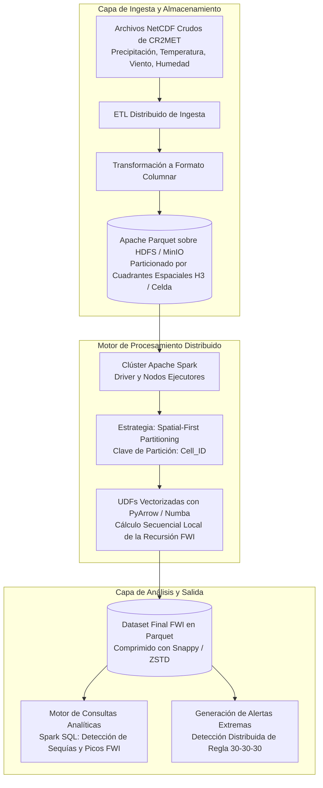

# Definición de Proyecto: Cálculo Distribuido del Índice de Peligro Meteorológico de Incendios (FWI) a Escala Nacional

**Asignatura:** Sistemas de Procesamiento para Big Data (Curso Electivo - UDP)  
**Profesor:** Dr. Nicolás Hidalgo  
**Entrega:** Definición del Problema (PD) – Especificación para Presentación e Informe  
**Formato de Referencia:** Paper de Conferencia IEEE / Investigación en Sistemas Distribuidos  

---

## 1. Resumen Ejecutivo y Metadatos

* **Título del Proyecto (Español):** Procesamiento Espacio-Temporal Distribuido del Índice Canadiense de Peligro de Incendios (FWI) sobre Mallas Climáticas Multidecadales de Alta Resolución en Chile.
* **Título del Proyecto (Inglés - para slides e informe IEEE):** *Distributed Spatio-Temporal Computation of Canadian Fire Weather Index (FWI) over Decadal High-Resolution Gridded Climate Data in Chile*.
* **Arquitectura Tecnológica Objetivo:** Apache Spark (PySpark / Scala) sobre clúster distribuido + Almacenamiento Columnar Optimizado (Apache Parquet / Delta Lake) sobre HDFS o almacenamiento de objetos compatible con S3 (MinIO).
* **Dataset Primario:** CR2MET v2.5 (Centro de Ciencia del Clima y la Resiliencia - Universidad de Chile / `vismet.cr2.cl`).
* **Paradigma Computacional:** Procesamiento Batch Distribuido Masivo y Computación sobre Tensores Espacio-Temporales.

---

## 2. Contexto y Antecedentes

Durante la última década, la zona centro y sur de Chile ha enfrentado temporadas de megaincendios sin precedentes en su historia registrada:
* **Temporada 2017 ("Tormenta de Fuego"):** Más de 570.000 hectáreas consumidas, destrucción de pueblos completos (como Santa Olga) y un comportamiento convectivo extremo nunca antes visto en el país.
* **Temporada 2023:** Más de 430.000 hectáreas arrasadas en las regiones de Ñuble, Biobío y La Araucanía, con decenas de víctimas fatales y miles de damnificados.

Este fenómeno responde a una conjunción crítica: más de 15 años de **megasequía ininterrumpida**, homogeneidad de combustible vegetal inflamable (plantaciones industriales de pino y eucalipto) y eventos meteorológicos extremos caracterizados por la regla empírica **"30-30-30"** (temperatura superior a $30^\circ\text{C}$, humedad relativa inferior a $30\%$ y vientos sostenidos superiores a $30\text{ km/h}$).

Para cuantificar el riesgo de ignición y propagación, los organismos operativos (como CONAF y SENAPRED) utilizan el estándar mundial: el **Sistema Canadiense de Índice de Peligro Meteorológico de Incendios Forestales (FWI - *Fire Weather Index*)**.

El sistema FWI no es un simple cálculo instantáneo; es un modelo contable no lineal, estratificado y con memoria acumulativa que estima:
1. **FFMC (*Fine Fuel Moisture Code*):** Humedad de la hojarasca superficial y combustibles finos muertos (tiempo de respuesta rápido: desfase de 16 a 24 horas).
2. **DMC (*Duff Moisture Code*):** Humedad de la capa orgánica en descomposición moderada (tiempo de respuesta: ~12 días).
3. **DC (*Drought Code*):** Humedad en capas orgánicas profundas del suelo, indicador directo de sequía acumulada estacional (tiempo de respuesta: ~52 días).
4. **ISI (*Initial Spread Index*):** Tasa potencial de propagación del fuego combinando el viento y el FFMC.
5. **BUI (*Buildup Index*):** Combustible total disponible para la combustión combinando DMC y DC.
6. **FWI (*Fire Weather Index*):** Intensidad frontal esperada del fuego (número adimensional representativo del peligro global).

### La limitación actual
Históricamente, el FWI se calcula únicamente de forma puntual donde existen **estaciones meteorológicas automáticas (EMA)**. Sin embargo, la red de estaciones en Chile es sumamente escasa y geográficamente heterogénea debido a la abrupta topografía de la cordillera y los valles, dejando enormes "puntos ciegos" en zonas rurales y de interfaz urbano-forestal de altísimo riesgo.

---

## 3. Definición y Motivación de la Problemática

### 3.1 El Cuello de Botella Computacional
Para superar la falta de estaciones y evaluar el riesgo de incendios de manera continua en todo el territorio continental, la comunidad científica desarrolló productos grillados interpolados de alta resolución como **CR2MET v2.5**.

CR2MET divide a Chile continental en una malla espacial de $0.05^\circ \times 0.05^\circ$ (~5 km $\times$ 5 km por celda), abarcando aproximadamente **20.000 celdas terrestres activas** con registros diarios continuos desde **1979 hasta 2023 (44 años)**.

* **Profundidad temporal:** ~16.000 días de registros diarios continuos.
* **Escala combinatorial:** $16.000 \text{ días} \times 20.000 \text{ celdas} \approx \mathbf{3.2 \times 10^8 \text{ celdas espacio-temporales}}$.
* **Variables requeridas por celda-día:** Temperatura Máxima y Mínima ($T_{max}, T_{min}$), Precipitación acumulada en 24h ($P$), Humedad Relativa calculada ($RH$) y Velocidad del Viento ($W$).
* **Dependencia de Estado Recursiva (Stateful Dependency):**  
  El cálculo del FWI en el día $t$ **depende obligatoriamente del estado del día anterior $t-1$**:
  $$FFMC_t = f(FFMC_{t-1}, T_t, RH_t, W_t, P_t)$$
  $$DMC_t = g(DMC_{t-1}, T_t, RH_t, P_t, \text{mes})$$
  $$DC_t = h(DC_{t-1}, T_t, P_t, \text{mes})$$

### 3.2 Por qué fracasan los métodos tradicionales (Mononodo)
1. **Colapso de Memoria (OOM - Out of Memory):** Cargar arrays climáticos multidimensionales NetCDF que cubren más de 4 décadas en la memoria de un solo computador colapsa la RAM y activa la memoria swap, degradando el rendimiento a niveles inutilizables.
2. **Ineficiencia de I/O en Formatos Científicos Tradicionales:** Los archivos NetCDF-4 están optimizados para lecturas por tajadas temporales o espaciales completas. Hacer consultas analíticas arbitrarias o simulaciones iterativas requiere recorrer secuencialmente archivos gigantescos en disco.
3. **Imposibilidad de Experimentación:** Si un científico o analista desea ajustar parámetros de ignición o evaluar escenarios climáticos futuros, una corrida secuencial en Python/R puede tardar más de 30 a 50 horas por experimento.

### 3.3 El Desafío Central de Sistemas Distribuidos
¿Cómo diseñar una arquitectura de almacenamiento y procesamiento distribuido que permita calcular el FWI sobre tensores climáticos multidecadales masivos, eliminando los cuellos de botella de red e I/O provocados por la recursión temporal de los datos?

---

## 4. Especificación de Datos y Justificación Big Data

El proyecto se sustenta en las dimensiones fundamentales de Big Data:

| Dimensión | Especificación Técnica |
| :--- | :--- |
| **Fuente Oficial** | Centro de Ciencia del Clima y la Resiliencia (CR2, Universidad de Chile / `vismet.cr2.cl`) |
| **Producto** | CR2MET v2.5 (Mallas de Precipitación y Temperatura Diaria) |
| **Formato Original** | NetCDF-4 (conforme a los estándares CF-1.6, arrays multidimensionales `[tiempo, latitud, longitud]`) |
| **Cobertura Espacial** | Chile Continental: Latitud $17.5^\circ\text{S} - 56.0^\circ\text{S}$, Longitud $76.0^\circ\text{W} - 66.0^\circ\text{W}$ |
| **Resolución Espacial** | Grilla de $0.05^\circ \approx 5 \text{ km} \times 5 \text{ km}$ (~20.000 celdas activas) |
| **Rango Temporal** | Datos diarios continuos desde el 1 de enero de 1979 al presente (>16.000 pasos de tiempo) |
| **Volumen** | Decenas de Gigabytes en arrays comprimidos NetCDF; más de **320 millones de estados espacio-temporales** a calcular |
| **Velocidad** | Cómputo histórico en Batch (44 años de línea base) + capacidad de ingesta incremental diaria para monitoreo de temporada activa |
| **Variedad** | Integración de arrays multidimensionales raster (NetCDF), tablas de telemetría de estaciones reales para validación (CSV/Parquet) y capas vectoriales de uso de suelo (CONAF) |

---

## 5. Arquitectura del Sistema y Estrategia de Procesamiento

### 5.1 Estrategia de Particionamiento Espacio-Temporal (Evitando el Shuffling de Red)
En sistemas distribuidos como Spark, el mayor enemigo del rendimiento es el **Shuffle** (traspaso masivo de datos entre nodos a través de la red).

* **El Error Típico:** Si particionas por fecha (un día por nodo), el cálculo del día $t$ obligaría a cada nodo a pedir por red el estado del día $t-1$ a otro nodo, saturando el ancho de banda del clúster en cada uno de los 16.000 días.
* **La Solución Propuesta (Spatial-First Partitioning):**  
  Particionar los datos por **Identificador de Celda Espacial (`Cell_ID`)**:
  1. Cada ejecutor de Spark recibe la serie temporal completa e ininterrumpida de 44 años para un subconjunto específico de celdas geográficas.
  2. Dentro de cada nodo ejecutor, la recursión temporal matemática del FWI se ejecuta localmente en memoria a velocidad nativa (utilizando funciones vectorizadas con PyArrow/Numba), con **cero comunicación de red entre nodos durante el cálculo recursivo**.
  3. Esto logra una paralelización vergonzosamente paralela (*embarrassingly parallel*) a nivel espacial.

### 5.2 Optimización de Almacenamiento: De NetCDF a Apache Parquet
* El formato NetCDF original es reestructurado a **Apache Parquet**, organizado columnarmente y ordenado físicamente por `(Cell_ID, timestamp)`.
* Se aplican esquemas de compresión como `Snappy` o `ZSTD`.
* Esto habilita **Predicate Pushdown** y proyección de columnas en Spark SQL, permitiendo que consultas como *"Filtrar todas las celdas de la Región del Biobío donde el FWI superó 50 en febrero de 2023"* lean únicamente los bloques relevantes del disco, acelerando la lectura en más de un 75%.

---

## 6. Plan de Evaluación Experimental (Para el Paper Final IEEE)

Para cumplir con la rúbrica del ramo, el proyecto contempla experimentos rigurosos de rendimiento en sistemas:

### 6.1 Métricas de Rendimiento en Sistemas Distribuidos
1. **Speedup y Escalabilidad Fuerte/Débil:** Evaluar el tiempo total de procesamiento variando el número de núcleos/ejecutores de Spark (1, 2, 4, 8 cores).
2. **Eficiencia de Almacenamiento e I/O:** Comparar tamaño en disco y latencia de lectura entre:
   * NetCDF crudo
   * CSV sin compresión
   * Apache Parquet con Snappy
   * Apache Parquet con Zstandard (ZSTD)
3. **Métricas de Red y Memoria:** Medir el volumen de datos transferidos por shuffle (`Shuffle Read/Write`) demostrando la efectividad de la partición espacial sobre la partición temporal.

### 6.2 Validación de Dominio (Ciencia de Datos)
* Comparar los picos calculados de FWI con el catálogo oficial de incendios históricos de CONAF durante los eventos catastróficos de enero-febrero de 2017 y febrero de 2023.
* Cuantificar la correlación entre días con condición "30-30-30" y la explosión de área quemada.

---

## 7. Estructura del Informe IEEE de 1 Página (Entrega del 11 de Septiembre)

El reporte en formato IEEE LaTeX de 1 página (10 pt, doble columna) se estructurará formalmente de la siguiente forma:

1. **Title & Abstract:** Contexto de megasequía, limitación de cómputo en estaciones puntuales y propuesta de un framework distribuido en Apache Spark sobre mallas climáticas CR2MET.
2. **Section I - Introduction & Motivation:** Magnitud del daño de incendios en Chile, fundamentos del sistema FWI y justificación de por qué procesar 320 millones de registros exige sistemas distribuidos.
3. **Section II - Dataset Characteristics:** Estructura técnica de CR2MET v2.5 (resolución de 5 km, 20.000 celdas, 44 años diarios, variables climáticas y formato NetCDF).
4. **Section III - Proposed Distributed Processing Architecture:** Pipeline de conversión a Parquet, estrategia de particionamiento espacial primero (*spatial-first partitioning*) y ejecución en clúster Spark con UDFs vectorizadas.
5. **Section IV - Evaluation Plan & Expected Impact:** Plan de pruebas de escalabilidad (Speedup, throughput de I/O) y su utilidad para la toma de decisiones preventiva en CONAF y SENAPRED.
6. **References:** Citas a papers clave de FWI (Van Wagner), arquitectura Spark (Zaharia et al.) y el dataset CR2MET (Boisier et al.).

---

## 8. Material de Apoyo: Guion y Diapositivas para la Presentación (5 Minutos)

> **Nota:** La presentación oral dura 5 minutos. Recuerda que la diapositiva debe estar escrita en **inglés** según la regla del curso. A continuación tienes la traducción exacta de lo que debe llevar cada slide y lo que puedes decir oralmente:

### Slide 1: Title & Authors (Tiempo: 30 seg)
* **Texto de la Slide (English):**
  * *Title:* Distributed Spatio-Temporal Computation of Fire Weather Danger (FWI) over Decadal Climate Grids in Chile
  * *Course:* Systems for Big Data Processing – Prof. Nicolás Hidalgo
  * *Team:* [Nombres de los integrantes]
* **Guion de Exposición (Español):**  
  *"Buenos días profesor y compañeros. Hoy les presentaremos la definición de nuestro proyecto, el cual aborda el procesamiento distribuido de índices de peligro de incendios forestales a escala nacional, utilizando datos climáticos masivos de alta resolución y Apache Spark."*

### Slide 2: Context & Background (Tiempo: 1 min)
* **Texto de la Slide (English):**
  * Chile's Wildfire Crisis: Over 1 million hectares burned in 2017 & 2023 megaseasons.
  * Driven by a 15-year megadrought and the "30-30-30" extreme meteorological rule.
  * Operation standard: Canadian Fire Weather Index (FWI) System (FFMC, DMC, DC, ISI, BUI, FWI).
  * Current Bottleneck: Historically computed only at scarce physical weather stations, creating hazardous blind spots across rural territories.
* **Guion de Exposición (Español):**  
  *"El contexto es crítico: en la última década, Chile ha sufrido temporadas de megaincendios devastadoras alimentadas por una megasequía de 15 años. El índice estándar para medir el peligro de fuego es el FWI canadiense, que modela la sequedad del combustible vegetal. El problema actual es que el FWI solo se calcula en estaciones meteorológicas físicas, las cuales son muy escasas en el país, dejando a la mayor parte del territorio rural a ciegas."*

### Slide 3: Problem Motivation & Systems Challenge (Tiempo: 1 min 15 seg)
* **Texto de la Slide (English):**
  * Solution: Compute FWI continuously across continental Chile using the CR2MET gridded dataset (~5 km resolution).
  * The Big Data Bottleneck:
    * 20,000 spatial cells $\times$ 16,000 days (1979–2023) = **$3.2 \times 10^8$ spatio-temporal evaluations**.
    * Strict temporal recurrence: Day $t$ calculations strictly depend on Day $t-1$ state.
  * Why Traditional Systems Fail: Single-node scripts (Python/R/QGIS) crash with Out-Of-Memory (OOM) errors and require dozens of hours of execution.
  * Research Goal: Design a distributed processing engine that eliminates memory bottlenecks and network shuffling overhead.
* **Guion de Exposición (Español):**  
  *"Para solucionar esto, queremos calcular el FWI celda por celda en todo Chile usando la grilla climática CR2MET. Pero esto genera un cuello de botella computacional masivo: son 20.000 celdas por 44 años de datos diarios, lo que supera los 320 millones de estados a computar. Además, el FWI es recursivo: el día de hoy depende del estado acumulado de ayer. En un computador normal, los scripts colapsan por falta de memoria RAM y demoran días en procesar. Nuestro problema de investigación es cómo paralelizar este cálculo en un clúster distribuido sin que el intercambio de red mate el rendimiento."*

### Slide 4: Dataset & Big Data Dimensions (Tiempo: 1 min)
* **Texto de la Slide (English):**
  * Dataset: CR2MET v2.5 Gridded Climate Product (from `vismet.cr2.cl`, CR2 / U. de Chile).
  * Volume: Tens of gigabytes in multidimensional NetCDF tensors (`[time, lat, lon]`).
  * Velocity: Decadal batch baseline + incremental daily processing during active wildfire seasons.
  * Variety: Multidimensional arrays (NetCDF-4), tabular ground truth stations, and categorical land-cover maps.
* **Guion de Exposición (Español):**  
  *"Para esto utilizaremos el dataset CR2MET v2.5, desarrollado por el Centro de Ciencia del Clima y la Resiliencia de la Universidad de Chile. Cumple plenamente las dimensiones de Big Data: en volumen, son decenas de gigabytes en tensores multidimensionales NetCDF; en velocidad, permite tanto el análisis histórico batch de 44 años como la ingesta incremental diaria durante el verano; y en variedad, integra arrays raster con datos tabulares de estaciones y capas de uso de suelo."*

### Slide 5: Proposed Big Data Architecture & Evaluation (Tiempo: 1 min 15 seg)
* **Texto de la Slide (English):**
  * Storage Optimization: Convert raw NetCDF to partitioned Apache Parquet on HDFS/MinIO (Snappy/ZSTD compression).
  * Processing Strategy: **Spatial-First Partitioning** in Apache Spark.
    * Each executor receives the full contiguous time-series of a spatial tile.
    * Zero network shuffle during temporal recursive loops; localized vectorized execution (PyArrow/Numba).
  * System Evaluation Plan:
    * Measure Speedup and Scale-up (1 to 8 worker cores).
    * Benchmark I/O throughput: NetCDF vs. CSV vs. Snappy/ZSTD Parquet.
    * Domain validation against historical CONAF wildfire ignition records (2017 & 2023).
* **Guion de Exposición (Español):**  
  *"Nuestra arquitectura propuesta resuelve el problema en dos capas: primero, convertimos los tensores NetCDF a formato columnar Apache Parquet en almacenamiento distribuido. Segundo, en Apache Spark aplicamos una estrategia de particionamiento espacial: cada ejecutor recibe la serie de tiempo completa de un cuadrante geográfico. Con esto, la recursión temporal se ejecuta 100% en memoria local mediante funciones vectorizadas, logrando cero saturación de red por shuffle. Finalmente, evaluaremos la escalabilidad del sistema midiendo el Speedup con múltiples nodos y validaremos la precisión de las alertas contrastándolas con los incendios reales registrados por CONAF."*
